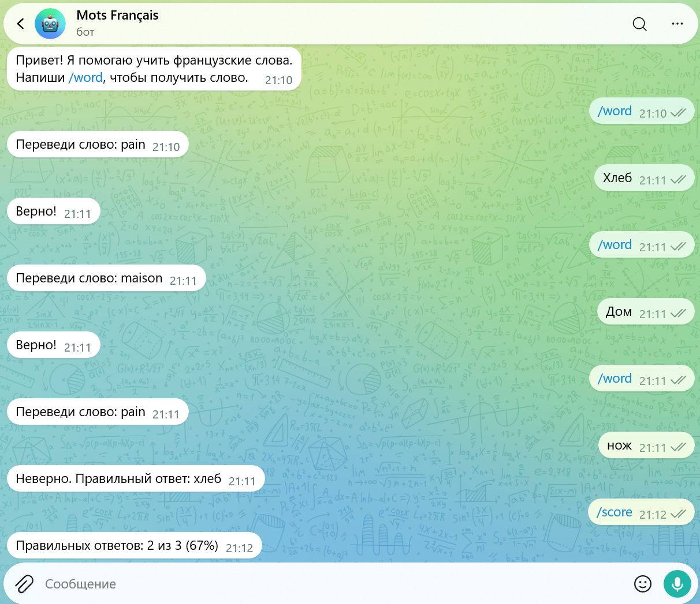

# french-words-bot

A Telegram bot for learning French words, written in Python and covered by pytest tests.

The bot sends a word, you reply with the translation, and it tells you if you are right. Your score is saved in a SQLite database, so it is kept after a restart.



## Features

- `/start` shows a greeting and the list of commands
- `/word` sends a French word, you translate it into Russian
- `/back` sends a Russian word, you translate it into French
- `/hint` shows the first letter of the answer
- `/score` shows how many answers were correct
- Answers are case-insensitive and ignore extra spaces
- The score of each user is stored in SQLite

## Project structure

- `words.py` is the word list and the main logic (checking answers, random word, hint, score text)
- `database.py` is the SQLite storage for scores
- `bot.py` is the Telegram bot
- `game.py` is a console version of the quiz
- `test_words.py`, `test_database.py`, `test_game.py` are the pytest tests

## How to run

1. Install dependencies:

```
pip install python-telegram-bot python-dotenv pytest
```

2. Create a bot with @BotFather in Telegram and copy its token.
3. Create a file named `.env` next to `bot.py`:

```
BOT_TOKEN=your_token_here
```

4. Start the bot:

```
python bot.py
```

The file `scores.db` is created automatically on the first start.

## Run the tests

```
pytest
```

The tests use a temporary database, so your real scores are never touched.

## What I practiced

- Python: functions, dictionaries, working with the Telegram Bot API
- Testing with pytest: parametrized tests, fixtures, `monkeypatch`, writing a test before the code
- SQLite: creating a table, parameterized queries (`?`) against SQL injection
- Git and GitHub: commits, push, `.gitignore`
- Keeping secrets out of the repository with `.env`